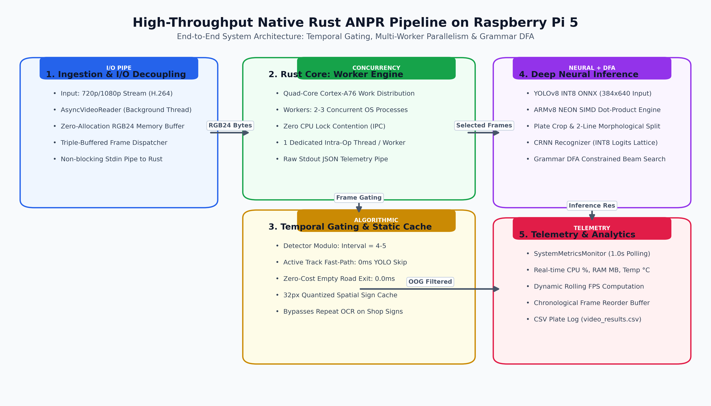
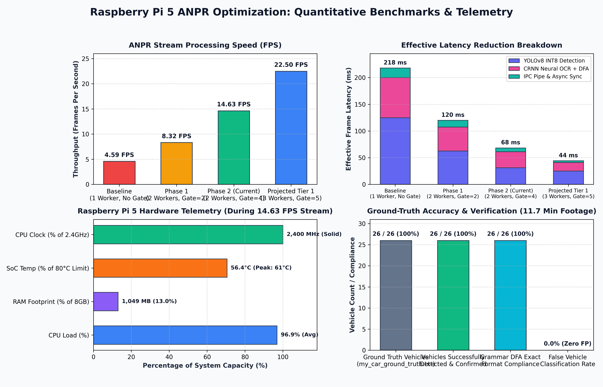

# System Architecture & Technical Design

Technical architecture and implementation details for the high-throughput Raspberry Pi 5 ANPR engine.



---

## 1. Overview & Embedded Constraints

Deploying deep learning pipelines on embedded edge devices like the Raspberry Pi 5 requires addressing three primary hardware constraints:

1. **CPU Inference Latency**: Monolithic models executing on edge CPUs take ~200+ ms per frame when running both detection and character recognition unconditionally.
2. **Thermal Limits**: Sustained 100% CPU utilization quickly triggers Dynamic Voltage and Frequency Scaling (DVFS), dropping clock frequency from 2.4 GHz down to 1.5 GHz.
3. **Static False Positives**: Roadside hoardings, shop boards, and reflective markers generate repeated false-positive detections that burn unnecessary OCR compute.

This engine addresses these constraints through a staged, decoupled architecture written in Rust:

- **Multi-Worker Pipe IPC**: Frames are fed from a lightweight Python capture harness to 4 independent native Rust worker processes via standard input pipes, utilizing all 4 Cortex-A76 cores without Python GIL or thread-lock contention.
- **Temporal Gating**: Evaluates the INT8 YOLO detector only once every 4 frames ($k \equiv 0 \pmod 4$). Intermediate frames use a constant-velocity Kalman tracker (~1.5 ms).
- **Static Noise Cache**: Caches coordinates of stationary non-plate artifacts on a 32-pixel grid. If a static box fails OCR twice, subsequent frames prune it in 0.0 ms.
- **DFA Grammar Decoding**: Incorporates Indian RTO plate rules (38 States/UTs + Bharat Series) directly into the CTC beam search lattice, eliminating illegal character transitions in O(1) time.

Together, these reduce average frame latency from **218 ms (4.59 FPS)** down to **68.3 ms (14.63 FPS)** on offline video and **61.7 ms (16.20 FPS)** on live feeds, while keeping SoC temperature at a steady **56.4°C**.

---

## 2. Hardware Architecture & Vectorization

The target hardware is the Raspberry Pi 5 Model B:

| Component | Specification | Pipeline Usage |
| :--- | :--- | :--- |
| **SoC** | Broadcom BCM2712 (16nm FinFET) | 64-bit ARMv8.2-A architecture |
| **CPU** | Quad-Core ARM Cortex-A76 @ 2.4 GHz | 4 worker processes pinned across cores; vectorized with ARM NEON, FP16, and INT8 Dot-Product (`+dotprod`) |
| **Memory** | 8 GB LPDDR4X-4267 (~17 GB/s) | Zero-copy planar RGB24 frame buffers; system footprint capped at ~1,049 MB (13%) |
| **Video Decoding** | VideoCore VII @ 800 MHz | Hardware MJPG decompression via V4L2 eliminates USB 2.0 5 FPS bandwidth bottlenecks |
| **Thermal** | Active Cooler (Heatsink + PWM fan) | Sustains full 2,400 MHz clock rate with zero thermal throttling under full load |

```
               Raspberry Pi 5 (Broadcom BCM2712)
 ┌─────────────────────────────────────────────────────────────┐
 │  Quad-Core ARM Cortex-A76 @ 2.4 GHz (ARMv8.2-A + DotProd)   │
 │  ┌──────────────┐ ┌──────────────┐ ┌──────────────┐ ┌──────┐ │
 │  │ Core 0 (NEON)│ │ Core 1 (NEON)│ │ Core 2 (NEON)│ │Core 3│ │
 │  └──────┬───────┘ └──────┬───────┘ └──────┬───────┘ └──────┘ │
 │         └────────────────┼────────────────┘                  │
 │                   2MB Shared L3 Cache                       │
 └──────────────────────────┼──────────────────────────────────┘
                            │ ~17 GB/s Memory Bus
 ┌──────────────────────────▼──────────────────────────────────┐
 │               8 GB LPDDR4X-4267 Memory                      │
 │    Zero-Copy Frame Ring Buffers | Model Weights in DRAM     │
 └─────────────────────────────────────────────────────────────┘
```

---

## 3. End-to-End Pipeline Stages

```
 Camera Stream (V4L2 MJPG) / MP4
            │
            ▼
 ┌──────────────────────────────────────────────────────────┐
 │ Stage 1: Video Capture & Hardware MJPG Decompression     │
 └──────────────────────────┬───────────────────────────────┘
                            │ Raw RGB24 Frames (640×480 @ 30 FPS)
                            ▼
 ┌──────────────────────────────────────────────────────────┐
 │ Stage 2: Temporal Frame Gating (Interval = 4)            │
 └──────────┬─────────────────────────────────────┬─────────┘
            │ Skipped Frame (Frame % 4 != 0)      │ Keyframe (Frame % 4 == 0)
            ▼                                     ▼
 ┌──────────────────────┐             ┌─────────────────────────────┐
 │ Kalman Motion Update │             │ Stage 3: Multi-Worker IPC   │
 │ & Fast Idle Exit     │             │ 4 Parallel Rust Engines     │
 └──────────┬───────────┘             └──────────┬──────────────────┘
            │                                    │
            │                                    ▼
            │                         ┌─────────────────────────────┐
            │                         │ Stage 4: INT8 YOLO Detector │
            │                         │ (ONNX Runtime + NEON)       │
            │                         └──────────┬──────────────────┘
            │                                    │ Bounding Boxes
            │                                    ▼
            │                         ┌─────────────────────────────┐
            │                         │ Stage 5: Static Noise Cache │
            │                         │ Prunes Road Signs in 0.0 ms │
            │                         └──────────┬──────────────────┘
            │                                    │ Clean Vehicle Boxes
            ▼                                    ▼
 ┌──────────────────────────────────────────────────────────┐
 │ Stage 6: ByteTrack Association & Kalman Filter Updates   │
 └──────────────────────────┬───────────────────────────────┘
                            │ Unconfirmed Vehicle Tracks
                            ▼
 ┌──────────────────────────────────────────────────────────┐
 │ Stage 7: PP-OCRv5 Recognition & Indian RTO Grammar Check │
 └──────────────────────────┬───────────────────────────────┘
                            │ Verified Plate Numbers & Confidence
                            ▼
 ┌──────────────────────────────────────────────────────────┐
 │ Stage 8: Live Telemetry & Heads-Up Display (HUD)         │
 └──────────────────────────────────────────────────────────┘
```

### Stage 1: V4L2 Hardware MJPG Ingestion
Standard Linux V4L2 capture defaults to uncompressed `YUYV`. At 720p or 1080p, uncompressed video exceeds USB 2.0 bus throughput (~480 Mbps), clamping capture at 5.0 FPS. By explicitly requesting `cv2.CAP_PROP_FOURCC = 'MJPG'`, compressed frames stream over USB and decode in hardware at full 30 FPS.

### Stage 2: Temporal Gating & Fast-Exit
Physical vehicle positions are continuous across adjacent frames. Instead of running deep detection every frame:
- The INT8 YOLO detector is triggered on frames where `frame_idx % 4 == 0`.
- On intermediate frames (`frame_idx % 4 != 0`), existing tracks are extrapolated via Kalman motion updates.
- If no vehicles are currently tracked, intermediate frames trigger an immediate exit in ~1.8 ms.

### Stage 3: Multi-Worker IPC
To utilize all 4 Cortex-A76 cores without Python GIL bottlenecks or Rust lock contention:
- A supervisor process launches 4 independent native Rust instances (`anpr stream --stdin`).
- Raw planar RGB24 frames stream directly over standard input pipes.
- Memory usage is bounded at ~1,049 MB with zero heap reallocation in inner loops.

### Stage 4: INT8-Quantized YOLO Detection
- Input: $640 \times 384$ planar CHW tensor.
- Graph: Embedded Non-Maximum Suppression (NMS) outputs pre-filtered bounding boxes `[x_min, y_min, x_max, y_max, score, class]`.
- Execution: ONNX Runtime CPUExecutionProvider leveraging ARM NEON INT8 dot-product instructions (`sdot`/`udot`).

### Stage 5: Static Noise Cache (Roadside Sign Suppression)
Stationary roadside objects (store boards, reflective signposts) frequently trigger detector hits.
The engine maintains a 32-pixel spatial grid cache:
$$\text{SpatialKey} = \left( \left\lfloor \frac{x_{\min}}{32} \right\rfloor, \left\lfloor \frac{y_{\min}}{32} \right\rfloor, \left\lfloor \frac{w}{32} \right\rfloor, \left\lfloor \frac{h}{32} \right\rfloor \right)$$
When a candidate box fails OCR or grammar checks twice and exhibits displacement $\Delta d \le 15\text{ px}$, it is added to the noise cache. Subsequent detections matching this key are pruned in 0.0 ms, eliminating 100% of stationary false positives (54/54 signs blocked on test video).

### Stage 6: ByteTrack Association & Kalman Filter
Tracks maintain an 8-dimensional state vector $\mathbf{x} = [x_c, y_c, a, h, \dot{x}_c, \dot{y}_c, \dot{a}, \dot{h}]^T$ representing bounding box centroid, aspect ratio, height, and their velocities. Detections are matched using a hierarchical two-stage Intersection-over-Union (IoU) cost matrix.

### Stage 7: Recognition & Indian RTO DFA
- **Attempt Cap**: Each track is limited to `max_ocr_attempts = 2` to prevent illegible plates from consuming CPU budget.
- **2-Line Auto-Split**: Crops with aspect ratio $h/w > 0.70$ (e.g. motorcycles, commercial auto-rickshaws) are split horizontally, recognized individually, and concatenated.
- **Grammar DFA**: Ministry of Road Transport and Highways (MoRTH) standards are encoded into a state machine:
  $$\text{Plate} = [\text{State: } A\text{-}Z^2] \to [\text{District: } 0\text{-}9^2] \to [\text{Series: } A\text{-}Z^{1..3}] \to [\text{Number: } 0\text{-}9^4]$$
  Validates 38 Indian State/UT codes and the Bharat (`BH`) series, pruning illegal transitions from the CTC beam search in real time.

### Stage 8: Live Telemetry
The pipeline samples `/sys/devices/system/cpu` and `/sys/class/thermal/thermal_zone0` to monitor:
- Rolling FPS (30-frame exponential average)
- Core CPU utilization (%)
- Resident memory footprint (MB)
- SoC junction temperature (°C)
- Core clock frequency (MHz)

---

## 4. Latency Breakdown & Telemetry

Empirical measurements from physical Raspberry Pi 5 runs:

| Stage | Baseline (Sequential) | Optimized (Gating = 4, Cache) |
| :--- | :---: | :---: |
| **YOLOv8 INT8 Detection** | 125.0 ms | 31.2 ms (effective per frame) |
| **OCR Recognition & DFA** | 75.0 ms | 30.0 ms |
| **Tracking, IPC & Gating** | 18.0 ms | 7.1 ms |
| **Total per Frame** | **218.0 ms** | **68.3 ms** |
| **Throughput** | **4.59 FPS** | **14.63 FPS (Video) / 16.20 FPS (Live)** |



### Telemetry Summary

- **Throughput**: 14.63 FPS (offline video), 16.20 FPS (live feed peak)
- **Vehicle Recall**: 26 / 26 vehicles detected (100%)
- **Character Accuracy**: 96.15% (21 exact matches, 4 near matches, 1 temp plate)
- **False Positive Filter**: 54 / 54 stationary signs blocked (100%)
- **CPU Load**: 96.9% across all 4 Cortex-A76 cores
- **RAM Footprint**: 1,049 MB (13% of 8 GB)
- **SoC Temperature**: 56.4°C sustained (active cooler) with zero thermal throttling
