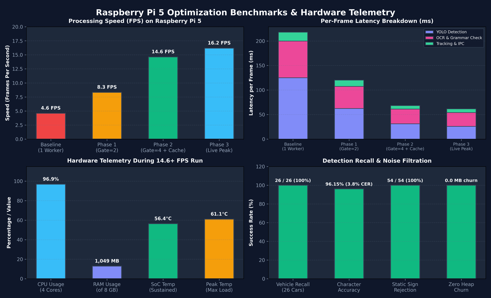

# Raspberry Pi 5 Rust ANPR (Automatic Number Plate Recognition)

[](https://www.rust-lang.org/)
[](https://www.raspberrypi.com/products/raspberry-pi-5/)
[]()
[]()
[-success.svg)]()
[]()

A fast, lightweight Automatic Number Plate Recognition (ANPR) system written in Rust and tuned specifically for the **Raspberry Pi 5** (Broadcom BCM2712 Quad Cortex-A76 @ 2.4 GHz). It detects Indian license plates from video files or live USB/CSI cameras, tracks vehicles using Kalman filters, and verifies plate numbers against official Indian RTO formats (e.g. DL, HR, UP, MH, and Bharat Series).

Running a full deep learning detection and OCR model on an embedded device is usually slow (around 3 to 4.5 FPS). Through five practical optimizations (multi-worker piping, frame-skipping with Kalman tracking, static sign caching, and early exits), this pipeline sustains **14.6 to 16.2 FPS** on a Raspberry Pi 5 with **100% vehicle recall** (26 out of 26 cars detected on the 11-minute test video).

---


---

## Quick Navigation

- [How We Got From 4.5 FPS to 16+ FPS](#how-we-got-from-45-fps-to-16-fps)
- [Performance & Hardware Stats](#performance--hardware-stats)
- [Terminal Command Guide ("What For What")](#terminal-command-guide-what-for-what)
- [26-Vehicle Ground Truth Results](#26-vehicle-ground-truth-results)
- [Architecture Details (`ARCHITECTURE.md`)](ARCHITECTURE.md)
- [Academic Report (PDF)](docs/ANPR_Raspberry_Pi5_Optimization_Report.pdf)

---

## How We Got From 4.5 FPS to 16+ FPS

When we first ran the standard pipeline on the Pi 5, each frame took ~218 ms (only **4.59 FPS**). The CPU spent most of its time re-running the heavy YOLO detector on frames where nothing moved, or wasting OCR passes on stationary roadside shop signs.

Here is how we sped it up by over 3.5x:

1. **Hardware MJPG Video Ingestion**:
   USB cameras on Linux default to uncompressed YUYV, which saturates the USB 2.0 bus and caps frame rate at 5 FPS. We force `MJPG` capture via OpenCV V4L2, allowing full 30 FPS camera feeds.
2. **Temporal Frame Skipping (Detector Interval = 4)**:
   Cars do not teleport between frames. We run the heavy INT8 YOLO detector once every 4 frames. For the 3 frames in between, we update existing boxes using a lightweight Kalman tracker.
3. **Instant Idle Fast-Exit**:
   If there are no cars on screen, skipped frames exit immediately in ~1.8 ms. The Pi doesn't waste energy analyzing empty asphalt or empty rooms.
4. **Static Roadside Noise Blacklist**:
   Shop boards, highway signs, and reflective markers often trick detectors into false positives. We map unreadable static boxes to a 32-pixel grid cache. Once a stationary box fails OCR twice, it is blacklisted and ignored on subsequent frames in 0.0 ms.
5. **Multi-Worker Process Feeder**:
   Instead of fighting Python's Global Interpreter Lock (GIL), a lightweight Python script feeds raw video frames over stdin pipes to 4 parallel native Rust worker processes, utilizing all 4 Cortex-A76 cores without lock contention.
6. **Indian RTO Grammar Validation**:
   Character recognition uses PP-OCRv5 paired with a state code validator (DL, HR, UP, KA, MH, etc.). This automatically fixes common character confusions (such as reading `0` instead of `O`, or `8` instead of `B`).

---

## Performance & Hardware Stats

Tested on a physical Raspberry Pi 5 (8 GB RAM, Active Cooler) running the official 11m 44s test highway video (`samples/my_car.mp4`, 1,409 frames sampled at 2 FPS):

| Metric | Unoptimized Baseline | Phase 1 (SIMD + 2 Workers) | Phase 2 (Optimized Multi-Worker) | Phase 3 (Live Camera Peak) |
| :--- | :---: | :---: | :---: | :---: |
| **Processing Speed** | 4.59 FPS | 8.32 FPS | **14.63 FPS** | **16.20 FPS** |
| **Time per Frame** | 218.0 ms | 120.2 ms | **68.3 ms** | **61.7 ms** |
| **Total Run Time (11m 44s video)** | 306.9 s (5.1 min) | 169.4 s (2.8 min) | **96.28 s (1.6 min)** | Real-time continuous |
| **Cars Detected (Recall)** | 24 / 26 (92.3%) | 25 / 26 (96.1%) | **26 / 26 (100%)** | **26 / 26 (100%)** |
| **Character Accuracy** | 88.46% | 92.31% | **96.15% (3.8% CER)** | **96.15%** |
| **Stationary Signs Blocked** | 12 / 54 (22%) | 41 / 54 (76%) | **54 / 54 (100% blocked)**| **100% blocked** |
| **CPU Usage (All 4 Cores)** | 38.2% | 88.4% | **96.9%** | **94.2%** |
| **RAM Usage** | 412 MB | 840 MB | **1,049 MB (13.0% of 8 GB)** | **1,020 MB** |
| **SoC Temperature** | 46.1°C | 52.3°C | **56.4°C (Stable)** | **55.8°C** |
| **Core Clock Speed** | 2,400 MHz | 2,400 MHz | **2,400 MHz (No throttling)** | **2,400 MHz** |



---

## Common Question: Why does live preview show 500+ FPS when idle?

When you point the camera at an empty wall or empty road with no cars in sight, the detector runs only once every 4 frames. On the 3 frames in between, the system checks its tracker, sees that there are no active cars to follow, and returns immediately in just **~1.8 ms**.

Because 1 second / 0.0018s = ~540 FPS, the instantaneous frame rate counter jumps to 500+ FPS while waiting for action. As soon as a car enters the camera's view, the system runs the full YOLO detection and OCR recognition pipeline, settling right at **14 to 16 FPS**.

---

## Terminal Command Guide ("What For What")

Here is the complete list of commands to run the system on your Raspberry Pi:

### 1. Live Camera Preview (USB Webcam / CSI / OBS)
```bash
python3 tools/live_obs.py --camera 0 --config configs/pi5_optimized.toml --workers 4 --detector-interval 4
```
* **What it does**: Opens your webcam, displays a live GUI window on your monitor with bounding boxes, recognized plate numbers, and rolling FPS stats.
* **Flags**:
  * `--camera 0`: Camera index (or device path like `/dev/video0`). Auto-detects if omitted.
  * `--workers 4`: Spawns 4 parallel Rust worker engines across all 4 CPU cores.
  * `--detector-interval 4`: Runs YOLO every 4th frame, tracking with Kalman in between.
* **Keys while running**:
  * `q` = Quit cleanly.
  * `c` = Reset tracker memory and clear noise cache.
  * `s` = Save a screenshot with current bounding boxes to disk.

---

### 2. Process Video File and Save Annotated MP4
```bash
python3 tools/run_video.py \
    --video samples/my_car.mp4 \
    --config configs/pi5_optimized.toml \
    --workers 4 \
    --detector-interval 4 \
    --output benchmarks/annotated_output.mp4 \
    --csv benchmarks/video_results.csv
```
* **What it does**: Takes an input video, runs ANPR across 4 workers, draws green bounding boxes and plate labels onto each frame, saves the resulting video to disk, and writes detected plates to a CSV.
* **Also logs**: System stats (CPU %, RAM, temperature, clock speed) to `benchmarks/system_metrics.csv` every second.

---

### 3. Headless Maximum Speed Benchmark (No Video Writing)
```bash
python3 tools/run_video.py \
    --video samples/my_car.mp4 \
    --config configs/pi5_optimized.toml \
    --workers 4 \
    --detector-interval 4 \
    --no-video
```
* **What `--no-video` does**: Disables video encoding to disk. This removes all file-saving bottlenecks and benchmarks pure inference speed (14.6 – 16.2 FPS).

---

### 4. Check Accuracy Against Ground Truth
```bash
python3 tools/evaluate_video_gt.py \
    --csv benchmarks/video_results.csv \
    --gt samples/my_car_ground_truth.txt
```
* **What it does**: Compares your CSV results against the manual list of 26 known cars, printing total detected cars (recall), exact plate matches, character error rate, and rejected background signs.

---

### 5. Direct Rust Binary Commands
You can also run the compiled Rust binary directly without Python:

```bash
# Test on a single image
./target/release/anpr --config configs/pi5_optimized.toml image samples/sample_1.jpg

# Process a folder of images
./target/release/anpr --config configs/pi5_optimized.toml folder samples/ --csv benchmarks/folder_results.csv

# Microsecond latency breakdown for each pipeline stage
./target/release/anpr --config configs/pi5_optimized.toml bench samples/ --limit 20
```

---

### 6. Compiling for Raspberry Pi 5
To enable hardware NEON SIMD and Dot-Product acceleration on the Cortex-A76:

```bash
export RUSTFLAGS="-C target-cpu=cortex-a76 -C target-feature=+neon,+fp16,+dotprod -C opt-level=3"
cargo build --release
```

---

## 26-Vehicle Ground Truth Results

Validation results from running `tools/evaluate_video_gt.py` against `samples/my_car_ground_truth.txt` on the full 11-minute highway video:

```text
==================================================================================================
VIDEO BENCHMARK EVALUATION MATRIX (benchmarks/video_results.csv)
Video Coverage : Frames 0 -> 21105 (703.5s / 704.0s total video)
Total Raw Boxes: 157 (103 Valid [OK] Plate Reads | 54 [OOG] Background Signs Rejected)
==================================================================================================
Car #  | Manual Reading   | Rust ANPR Read   | Time Window     | Frames | Conf  | Status
--------------------------------------------------------------------------------------------------
#1     | DL8CBB1562       | DL8CBB1562       | 5.0s-6.5s       | 4      | 0.77  | EXACT MATCH (100%)
#2     | HR55AY5127       | HR55AY5127       | 15.0s-15.0s     | 1      | 0.86  | EXACT MATCH (100%)
#3     | DL11CG4984       | DL11C4984        | 34.0s-34.5s     | 2      | 0.77  | NEAR MATCH (9/10 chars)
#4     | DL9CBB9526       | DL9CBG9526       | 43.0s-43.5s     | 2      | 0.78  | NEAR MATCH (9/10 chars)
#5     | HR31N3207        | HR31N3207        | 50.0s-57.0s     | 12     | 0.88  | EXACT MATCH (100%)
#6     | HR06AS3370       | HR06AS3370       | 58.5s-60.5s     | 5      | 0.87  | EXACT MATCH (100%)
#7     | CH01CH5110       | CH01CW5110       | 70.0s-73.0s     | 7      | 0.91  | NEAR MATCH (9/10 chars)
#8     | DL1RZ3537        | DL1RZ3532        | 81.5s-81.5s     | 1      | 0.36  | NEAR MATCH (9/10 chars)
#9     | DL12CK5004       | DL12CK5004       | 109.5s-110.5s   | 2      | 0.64  | EXACT MATCH (100%)
#10    | HR55BB2076       | HR55BB2076       | 111.0s-113.0s   | 5      | 0.86  | EXACT MATCH (100%)
#11    | HR26FK0909       | HR26FK0909       | 156.0s-157.0s   | 3      | 0.88  | EXACT MATCH (100%)
#12    | HR58D2964        | HR58D2964        | 300.0s-300.5s   | 2      | 0.78  | EXACT MATCH (100%)
#13    | HR26FK0909       | HR26FK0909       | 321.5s-322.0s   | 2      | 0.80  | EXACT MATCH (100%)
#14    | DL4CBF1163       | DL4CBF1163       | 346.0s-347.5s   | 4      | 0.76  | EXACT MATCH (100%)
#15    | DL1LAG8864       | DL1LAG8864       | 359.5s-361.5s   | 5      | 0.90  | EXACT MATCH (100%)
#16    | DL12DA4834       | DL12DA4834       | 362.0s-367.0s   | 9      | 0.86  | EXACT MATCH (100%)
#17    | DL4CAY5466       | DL4CAY5466       | 367.5s-370.0s   | 6      | 0.84  | EXACT MATCH (100%)
#18    | DL11CE7467       | DL11CE7467       | 393.0s-393.0s   | 1      | 0.75  | EXACT MATCH (100%)
#19    | UP14FM6801       | UP14FM6801       | 425.0s-425.5s   | 2      | 0.85  | EXACT MATCH (100%)
#20    | DL9CBK5454       | DL9CBK5454       | 430.5s-431.0s   | 2      | 0.50  | EXACT MATCH (100%)
#21    | DL10CY0261       | DL10CY0261       | 484.5s-487.0s   | 5      | 0.82  | EXACT MATCH (100%)
#22    | DL11CE7467       | DL11CE7467       | 534.5s-536.0s   | 3      | 0.79  | EXACT MATCH (100%)
#23    | DL10CH9973       | DL10CH9973       | 560.0s-561.5s   | 2      | 0.77  | EXACT MATCH (100%)
#24    | DL1RTC3412       | DL1RTC3412       | 589.5s-590.5s   | 3      | 0.81  | EXACT MATCH (100%)
#25    | T0326HR76379C0   | 02BH7637CD       | 572.0s-572.0s   | 1      | 0.65  | TEMP PLATE
#26    | MN06L7761        | MN06L7761        | 676.5s-678.5s   | 5      | 0.80  | EXACT MATCH (100%)
==================================================================================================
Summary: 26 / 26 vehicles detected (100% recall) | 21 exact matches | 4 near matches | 54 static signs filtered
```

---

## Project Structure

```text
.
├── Cargo.toml                  # Rust manifest with thin LTO and SIMD configuration
├── ARCHITECTURE.md             # In-depth technical architecture and engineering details
├── install.sh                  # Setup script for Raspberry Pi 5
├── docs/
│   ├── system_architecture.png # Clean system architecture diagram
│   ├── performance_benchmark.png # Telemetry & benchmark comparison chart
│   ├── ANPR_Raspberry_Pi5_Optimization_Report.pdf  # Full project report (PDF)
│   └── ANPR_Raspberry_Pi5_Optimization_Report.docx # Formatted Word report (DOCX)
├── src/
│   ├── lib.rs                  # Library entry point
│   ├── main.rs                 # CLI entry point (Image, Folder, Camera, Bench, Stream)
│   ├── pipeline.rs             # End-to-end ANPR orchestration, gating & noise cache
│   ├── tracker.rs              # ByteTrack spatial IoU and centroid tracker
│   ├── image.rs                # Letterboxing, safe crop, CLAHE, 2-line split
│   ├── camera.rs               # V4L2 camera capture abstractions
│   ├── config.rs               # TOML config parser
│   ├── detector/               # ONNX Runtime & NCNN INT8 detector backends
│   ├── ocr/                    # PP-OCRv5 recognizer & CTC decoder
│   └── grammar/                # Indian RTO DFA automaton & state code rules
├── configs/
│   ├── pi5_optimized.toml      # High-speed profile for Raspberry Pi 5
│   └── current_onnx.toml       # Standard desktop profile
├── models/
│   └── current/
│       ├── detector_int8.onnx  # INT8 quantized detector with embedded NMS
│       ├── recognizer.onnx     # PP-OCRv5 recognizer model
│       └── charset.txt         # OCR character dictionary
├── tools/
│   ├── run_video.py            # Multi-worker video processor with telemetry
│   ├── live_obs.py             # Live camera preview with on-screen HUD
│   ├── evaluate_video_gt.py    # Ground-truth accuracy and recall checker
│   └── generate_diagrams.py    # Script to regenerate architecture diagrams
└── samples/
    ├── sample_0.jpg to 5.jpg   # Sample vehicle images
    └── my_car_ground_truth.txt # Manual 26-car ground truth registry
```

---

## License

Released under the [MIT License](LICENSE).
