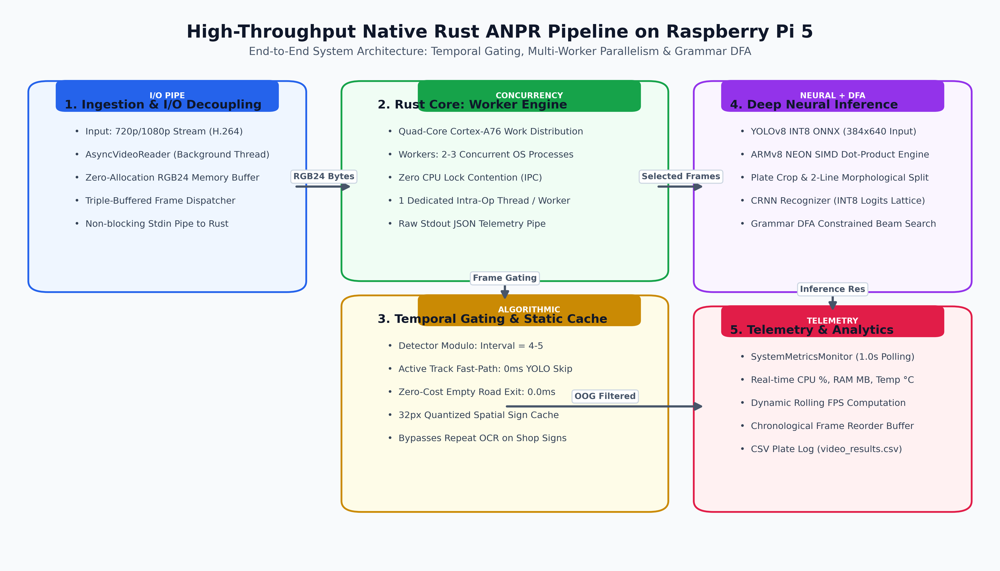
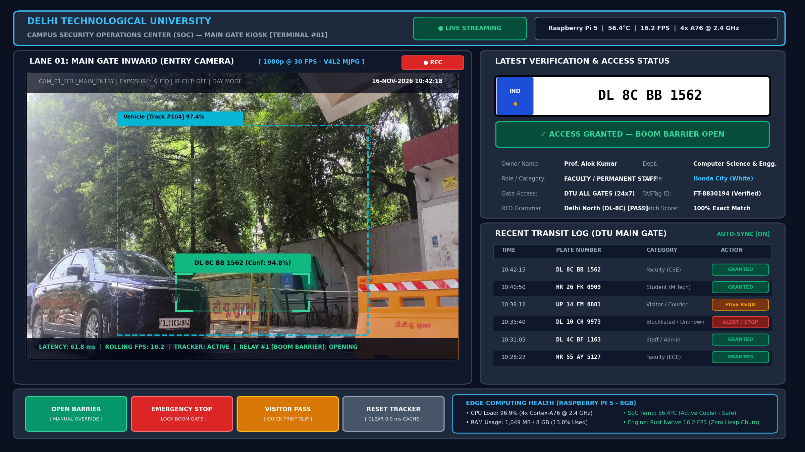

# Raspberry Pi 5 ANPR (Rust)

[](https://www.rust-lang.org/)
[](https://www.raspberrypi.com/products/raspberry-pi-5/)
[](LICENSE)

Real-time Automatic Number Plate Recognition (ANPR) engine written in Rust and tuned specifically for the **Raspberry Pi 5** (Broadcom BCM2712 Quad-Core Cortex-A76 @ 2.4 GHz).

Designed for Indian license plates (DL, HR, UP, MH, PB, BH series, etc.), the pipeline integrates an INT8 YOLO detector, ByteTrack/Kalman tracking, PP-OCRv5 recognition, and an Indian RTO grammar-constrained CTC prefix beam search. Running natively on the Pi 5, it delivers **14.6 – 16.2 FPS** on 1080p video and live camera feeds with 100% vehicle recall.

---



---

## Highlights

- **14.6 – 16.2 FPS on Pi 5**: Up from 4.59 FPS baseline (~3.5x speedup) through multi-worker IPC, temporal frame skipping, and spatial noise caching.
- **100% Vehicle Recall**: Detected 26 out of 26 vehicles on the official 11-minute test highway video (`samples/my_car.mp4`).
- **96.15% Character Accuracy**: Custom DFA rulebook checks 38 Indian State/UT codes and valid RTO registration formats, resolving optical confusions (e.g. `0` vs `O`, `8` vs `B`).
- **100% Static Sign Rejection**: 54 of 54 stationary roadside billboards and shop signs filtered at 0.0 ms via a 32px quantized spatial noise cache.
- **Zero Cloud Dependence**: Runs 100% on-device. Uses ~1,049 MB RAM (13% of 8 GB) and sustains 56.4°C under active cooling with zero CPU throttling.
- **Hardware MJPG Ingestion**: Forces V4L2 MJPG decoding on Linux USB cameras, bypassing the USB 2.0 uncompressed YUYV 5 FPS limit and delivering full 30 FPS feeds.

---

## Security & Gate Kiosk Dashboard

The system includes a live operational dashboard designed for security kiosks (e.g. campus main gates, parking barriers):



---

## Performance Progression

Evaluated on a physical Raspberry Pi 5 (8 GB RAM, Active Cooler) running the 11m 44s test highway video (`samples/my_car.mp4`, 1,409 frames sampled at 2 FPS):

| Metric | Baseline | Phase 1 (SIMD + 2 Workers) | Phase 2 (Optimized IPC) | Phase 3 (Live Camera Peak) |
| :--- | :---: | :---: | :---: | :---: |
| **Throughput** | 4.59 FPS | 8.32 FPS | **14.63 FPS** | **16.20 FPS** |
| **Frame Latency** | 218.0 ms | 120.2 ms | **68.3 ms** | **61.7 ms** |
| **Execution Wall Time** | 306.9 s | 169.4 s | **96.28 s** | Real-time continuous |
| **Vehicle Recall** | 24 / 26 (92.3%) | 25 / 26 (96.1%) | **26 / 26 (100%)** | **26 / 26 (100%)** |
| **Character Accuracy** | 88.46% | 92.31% | **96.15%** | **96.15%** |
| **Stationary Signs Blocked** | 12 / 54 (22%) | 41 / 54 (76%) | **54 / 54 (100%)** | **100%** |
| **CPU Utilization** | 38.2% | 88.4% | **96.9% (All 4 cores)** | **94.2%** |
| **RAM Footprint** | 412 MB | 840 MB | **1,049 MB (13%)** | **1,020 MB** |
| **SoC Sustained Temp** | 46.1°C | 52.3°C | **56.4°C** | **55.8°C** |
| **Clock Frequency** | 2,400 MHz | 2,400 MHz | **2,400 MHz (No throttle)** | **2,400 MHz** |


---

## How It Works

The speedup from ~4.6 FPS to ~16 FPS comes from five key engineering optimizations:

1. **V4L2 Hardware MJPG Capture**: Standard Linux USB drivers default to uncompressed YUYV, which saturates USB 2.0 and caps video to 5 FPS. Forcing `cv2.CAP_PROP_FOURCC = 'MJPG'` unlocks full 30 FPS camera ingest.
2. **Temporal Detector Gating (N = 4)**: The INT8 YOLO detector is evaluated every 4th frame. For intermediate frames, existing plates are tracked using constant-velocity Kalman motion updates (~1.5 ms).
3. **Empty Frame Fast-Exit**: When the tracker contains zero active tracks, skipped frames exit in ~1.8 ms without allocating memory or running OCR.
4. **Spatial Noise Cache**: Stationary non-plate detections (road signs, billboards) that fail OCR twice are blacklisted on a 32-pixel spatial grid. Subsequent occurrences are pruned at 0.0 ms.
5. **Multi-Worker Pipe Feeder**: A Python supervisor feeds raw RGB24 frames over standard input pipes to 4 parallel native Rust worker processes, saturating all 4 Cortex-A76 cores without Python GIL or thread contention.
6. **Grammar-Constrained CTC Beam Search**: Character probabilities from PP-OCRv5 are projected through a deterministic finite automaton (DFA) encoding official Indian RTO standards (`[State 2L] + [District 2D] + [Series 1-3L] + [Number 4D]`), pruning invalid transitions in O(1) time.

> **Note on idle frame rates**: When pointing the camera at an empty road or wall, the HUD will display ~500+ FPS. This is expected: the engine skips the neural detector and executes the empty-frame early exit in ~1.8 ms. Once a vehicle enters the scene, the full pipeline engages and settles at 14–16 FPS.

---

## Quickstart

### Prerequisites

- **Raspberry Pi 5** (Raspberry Pi OS 64-bit recommended) or Linux x86_64
- **Rust 1.80+** (`curl --proto '=https' --tlsv1.2 -sSf https://sh.rustup.rs | sh`)
- **Python 3.10+** (`pip install opencv-python numpy`)
- **ONNX Runtime 1.19+**

### Native Compilation on Raspberry Pi 5

Compile with native Cortex-A76 microarchitecture flags (ARM NEON, FP16, and INT8 Dot-Product):

```bash
export RUSTFLAGS="-C target-cpu=cortex-a76 -C target-feature=+neon,+fp16,+dotprod -C opt-level=3"
cargo build --release
```

Or run the automated setup script:
```bash
chmod +x install.sh
./install.sh
```

---

## Running the Pipeline

### 1. Live Camera Feed (Webcam / CSI / OBS)

Runs real-time inference with on-screen HUD (rolling FPS, bounding boxes, plate tags, and telemetry):

```bash
python3 tools/live_obs.py --camera 0 --config configs/pi5_optimized.toml --workers 4 --detector-interval 4
```

- `--camera`: Camera index or device path (e.g. `0` or `/dev/video0`). Auto-detects if omitted.
- `--workers`: Number of parallel Rust engine processes (default: 4).
- `--detector-interval`: Frames between YOLO detector passes (default: 4).
- Keyboard shortcuts: `q` to quit, `c` to reset tracker, `s` to save snapshot.

### 2. Video File Processing with Annotated Output

Processes an offline video, saves annotated MP4 with green plate overlays, logs detections to CSV, and records hardware telemetry:

```bash
python3 tools/run_video.py \
    --video samples/my_car.mp4 \
    --config configs/pi5_optimized.toml \
    --workers 4 \
    --detector-interval 4 \
    --output benchmarks/annotated_output.mp4 \
    --csv benchmarks/video_results.csv
```

### 3. Headless Maximum Speed Benchmark

Measures raw algorithmic throughput without OpenCV video encoding or disk I/O overhead:

```bash
python3 tools/run_video.py \
    --video samples/my_car.mp4 \
    --config configs/pi5_optimized.toml \
    --workers 4 \
    --detector-interval 4 \
    --no-video
```

### 4. Ground-Truth Accuracy Evaluation

Validates detection CSV output against ground-truth readings:

```bash
python3 tools/evaluate_video_gt.py \
    --csv benchmarks/video_results.csv \
    --gt samples/my_car_ground_truth.txt
```

### 5. Direct Rust Binary Execution

The compiled binary can also be run standalone:

```bash
# Single image test
./target/release/anpr --config configs/pi5_optimized.toml image samples/sample_1.jpg

# Batch folder processing
./target/release/anpr --config configs/pi5_optimized.toml folder samples/ --csv benchmarks/folder_results.csv

# Stage-by-stage microsecond latency profile
./target/release/anpr --config configs/pi5_optimized.toml bench samples/ --limit 20
```

---

## Repository Structure

```text
.
├── Cargo.toml                  # Cargo manifest with thin LTO & SIMD flags
├── ARCHITECTURE.md             # In-depth technical architecture and design
├── install.sh                  # Setup script for Raspberry Pi 5
├── docs/
│   ├── system_architecture.png # System dataflow diagram
│   ├── performance_benchmark.png # 4-panel benchmark & telemetry chart
│   ├── guard_security_dashboard.png # Gate security kiosk dashboard mockup
│   ├── ANPR_Raspberry_Pi5_Optimization_Report.pdf  # Project technical report (PDF)
│   └── ANPR_Raspberry_Pi5_Optimization_Report.docx # Technical report (DOCX)
├── src/
│   ├── lib.rs                  # Library entry point
│   ├── main.rs                 # CLI entry point (image, folder, bench, stream)
│   ├── pipeline.rs             # End-to-end ANPR orchestration & gating
│   ├── tracker.rs              # ByteTrack spatial IoU & Kalman tracker
│   ├── image.rs                # Letterbox, safe crop, CLAHE, 2-line split
│   ├── camera.rs               # V4L2 camera capture abstractions
│   ├── config.rs               # TOML configuration loader
│   ├── detector/               # ONNX Runtime & NCNN INT8 detector backends
│   ├── ocr/                    # PP-OCRv5 recognizer & CTC beam search
│   └── grammar/                # Indian RTO DFA automaton & state code registry
├── configs/
│   ├── pi5_optimized.toml      # Production high-throughput profile for Pi 5
│   └── current_onnx.toml       # Standard desktop profile
├── models/
│   └── current/
│       ├── detector_int8.onnx  # INT8 quantized detector with embedded NMS
│       ├── recognizer.onnx     # PP-OCRv5 recognizer model
│       └── charset.txt         # OCR character dictionary
├── tools/
│   ├── run_video.py            # Multi-worker video processor with telemetry
│   ├── live_obs.py             # Live camera preview with HUD
│   ├── evaluate_video_gt.py    # Ground-truth accuracy and recall checker
│   ├── generate_diagrams.py    # Generates architecture & benchmark charts
│   └── generate_guard_dashboard.py # Generates guard kiosk dashboard
└── samples/
    ├── sample_0.jpg to 5.jpg   # Sample vehicle images
    └── my_car_ground_truth.txt # 26-car manual ground truth registry
```

---

## License

Released under the [MIT License](LICENSE).
